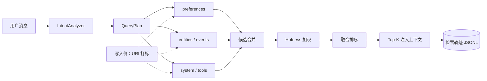

# Agent 记忆系统：目录化组织与意图感知检索

> 存了十万条记忆，用户问"上次那个项目"还是找不到。问题通常不在 embedding 模型，而在检索之前少了一步：先判断这次要找的是哪一类记忆。把所有记忆当成一个扁平池子做 top-k，等于让语义相似度同时承担"找什么"和"在哪找"两个职责，而它只擅长后者的一半。

[OpenViking](https://github.com/volcengine/OpenViking)（火山引擎开源，2026-10 已有 4 万+ star）给了一个不同的思路：把 Agent 记忆、知识 RAG 和技能统一成一套上下文数据库，用文件系统的目录树组织记忆，检索时先定位目录，再在目录内搜索。这篇文章借它的五个设计，讲一套可以独立落地的记忆检索方案。

::: tip 先说明边界
下面所有公式和代码都是**参考实现**，不是 OpenViking 上游源码的逐行复刻。目录名、意图分类和系数都应按你的业务调整；直接照搬一套 11 类意图和 8 个目录，通常比不做还糟。
:::

---

## 向量检索不是没用，是找不准

扁平记忆的典型链路是：把每条记忆切块、算 embedding、塞进向量库；查询时把用户原句也 embedding 一次，取相似度最高的 K 条。

这条链路对"知识问答"很有效，因为问题和知识片段在语义上本来就接近。但记忆召回的场景不一样：用户的查询往往很短、指代很多，真正的目标是一条**具体发生过的事**，而不是一段语义相近的文本。

| 失败类型 | 用户怎么说 | 扁平检索会捞回什么 | 根因 |
|---|---|---|---|
| 实体指代不清 | "上次那个项目叫什么" | 一堆讲"项目"的泛泛段落 | 查询里没有项目名，向量只能按"项目"这个主题找 |
| 事件召回失败 | "那天说的方案再讲一遍" | 最近的、语义像"方案"的内容 | "那天"是时间/事件线索，不是语义线索 |
| 新旧偏好冲突 | "我现在喜欢什么风格" | 旧偏好和新偏好一起返回 | 没有按时间、状态、权威性做区分 |
| 规则被稀释 | "有什么不能做的" | 大量普通记忆挤掉那几条硬规则 | 规则条目少，top-k 里天然吃亏 |

这些问题不是换个更大的 embedding 模型就能解决的。它们缺的是**检索范围**和**意图信号**：先知道该去哪一类记忆里找，再谈相似度。

| 维度 | 扁平向量检索 | 目录化 + 定向检索 |
|---|---|---|
| 召回单位 | 全库 top-k | 先选目录，再在目录内 top-k |
| 查询信号 | 原句语义 | 意图 + 实体 + 时间 + 规则类型 |
| 可解释性 | 只有一个相似度分数 | 能说清"为什么去这个目录" |
| 主要误差 | 语义漂移、旧记忆干扰 | 意图分类错、目录打标错 |
| 成本 | 一次向量检索 | 一次规划 + 多路小范围检索 |

**什么时候不必上这套：** 记忆条目少于一千条、查询本身足够明确（"我的邮箱是什么"）、或者你已经有很强的结构化查询条件。这时候扁平检索加 metadata filter 更简单，维护成本也更低。目录化解决的是"规模变大之后，查询仍然模糊"的问题。

---

## 改造后的链路：先定目录，再检索

改造的核心不是加一个分类器，而是把"检索"拆成两个可分别验证的步骤：

```text
改造前：query → embedding → 全库相似度排序 → top-k

改造后：query → IntentAnalyzer → QueryPlan
                    → 按目录多路检索 → Hotness 加权 → 融合排序 → top-k
                    → 检索轨迹（意图、目录、各路得分、最终选择）
```



这里有两个容易被忽略的设计点：

1. **计划是数据，不是代码。** `QueryPlan` 是一个可序列化的对象，能写日志、能做单测、能离线回放。把"怎么搜"硬编码在 if-else 里，出了问题只能加日志重新猜。
2. **检索策略是受控枚举。** 只允许 `exact_match`、`semantic`、`bm25` 三种，后端换实现时不影响计划层；新增策略必须显式改枚举，避免某个 LLM 输出一个后端不认识的字符串。

```python
from dataclasses import dataclass
from typing import Literal

Strategy = Literal["exact_match", "semantic", "bm25"]

@dataclass(frozen=True)
class TypedQuery:
    text: str
    dirs: tuple[str, ...]
    strategy: Strategy
    weight: float = 1.0

@dataclass(frozen=True)
class QueryPlan:
    intent: str
    queries: tuple[TypedQuery, ...]
    source: Literal["llm", "heuristic"]
    fallback: bool = False
```

`fallback` 用来区分"正常走启发式"和"LLM 规划失败后退回启发式"。这两个状态在日志里必须分开，否则你无法判断 LLM 到底有没有在工作。

---

## 积木 1：URI 命名空间——写入时就分好类

检索时能不能按目录缩小范围，取决于写入时有没有打好标签。等查询来了再分类，不但慢，而且查询里往往根本没有足够的信息。

URI 命名空间本质上是给每条记忆一个**层级化的地址**，而不是一个扁平的 `category` 字段：

| 目录 | 放什么 | 例子 | 生命周期 |
|---|---|---|---|
| `preferences` | 稳定的用户偏好 | "代码统一用 black 格式化" | 长期，可被新偏好覆盖 |
| `entities` | 人、项目、公司、工具等实体 | "项目 A 用的是 PostgreSQL" | 长期，需去重 |
| `events` | 发生过的事、时间点、决策过程 | "上周决定先不做多租户" | 中期，可归档 |
| `patterns` | 可复用的经验与方法 | "这个团队发布前必须跑回归" | 长期 |
| `tools` | 工具、平台、配置、安装方式 | "CI 用 GitHub Actions" | 中期 |
| `skills` | 具体操作技能 | "如何用 docker compose 起本地依赖" | 长期 |
| `system` | 规则、约束、身份设定 | "不能把密钥提交到 git" | 长期，优先级最高 |
| `general` | 无法归类的兜底 | 临时笔记、杂项 | 短期，定期清理 |

`subject` 必须进 URI。多用户或多租户系统里，如果地址只有目录没有归属，检索时很容易把别人的记忆捞进来。OpenViking 使用的是 `viking://` 前缀；这里用 `mem://` 只是为了说明这是应用自己的命名空间，换成任何稳定前缀都可以。

```python
CATEGORY_DIR = {
    "user_preference": "preferences",
    "preference": "preferences",
    "event": "events",
    "pattern": "patterns",
    "devops": "tools",
    "skill": "skills",
    "entity": "entities",
    "iron_rule": "system",
    "system": "system",
}

DIR_KEYWORDS = {
    "preferences": ("偏好", "喜欢", "不喜欢", "风格", "习惯"),
    "entities": ("项目", "工具", "平台", "公司", "团队"),
    "events": ("那天", "上次", "之前", "发生过", "经历"),
    "patterns": ("方法", "流程", "步骤", "经验", "教训"),
    "tools": ("插件", "API", "配置", "安装", "部署"),
    "skills": ("技能", "怎么做", "如何实现"),
    "system": ("规则", "铁律", "不能", "禁止", "必须"),
}

DIRS = ("preferences", "entities", "events", "patterns", "tools", "skills", "system", "general")

def classify_uri_tag(category: str, content: str, subject: str = "user") -> str:
    """三级打标：category 精确匹配 → 内容关键词 → general 兜底。"""
    dir_name = CATEGORY_DIR.get(category)
    if dir_name is None:
        text = content.lower()
        for name in DIRS:
            if any(kw in text for kw in DIR_KEYWORDS.get(name, ())):
                dir_name = name
                break
    return f"mem://{subject}/{dir_name or 'general'}/"
```

这段代码有三个必须知道的局限：

- **关键词是子串匹配。** "哥"会命中"哥哥"，"项目"会命中"项目组"，中文没有空格，不能靠词边界解决。关键词表只适合做粗筛，重要目录（尤其是 `system`）应该允许人工覆盖或走 LLM 复核。
- **顺序即优先级。** `DIRS` 的顺序决定了同一个句子命中多个关键词时归到哪一类。规则和约束应该排在通用目录之前，否则"不能把密码提交到 git"很容易因为命中"提交"之类的词落进 `tools`。
- **标签要可重跑。** 打标逻辑一定会改，记忆条目要带 `tag_version`，支持按版本离线回填；回填必须先 dry-run，抽样人工检查，再全量写回。

::: warning 目录不是权限边界
`mem://user/alice/preferences/` 只是检索范围。真正的权限控制仍然要依赖 `subject`、ACL 和查询时的强制过滤。不要因为"已经按用户分目录"就省略权限校验——目录可以被写错，权限不能靠约定。
:::

写入侧还要解决重复问题。同一个偏好被反复说出来时，应该按 `(subject, dir, normalized_key)` 做 upsert，而不是无限追加。否则检索时会把十条几乎一样的旧偏好一起捞回来，反而稀释了最新那条。

---

## 积木 2：IntentAnalyzer——先想清楚要找什么

有了目录标签，下一步是回答"这次该去哪几个目录找"。IntentAnalyzer 的职责不是做情感分类，而是生成一个**检索计划**：把一句模糊的话翻译成若干条带目录、带策略、带权重的查询。

下面是一套可用的意图分类。11 类不是标准答案，只是覆盖了记忆召回里最常见的几种情况：

| 意图 | 典型说法 | 目标目录 | 主策略 |
|---|---|---|---|
| `preference_update` | "以后都用 pnpm" | preferences | semantic |
| `preference_query` | "我喜欢什么代码风格" | preferences | semantic |
| `entity_recall` | "上次那个项目叫什么" | entities, events | semantic |
| `event_recall` | "那天说的方案再讲一遍" | events, entities | semantic |
| `decision_trace` | "当时为什么选了这个方案" | events, patterns, entities | bm25 |
| `rule_statement` | "不能把密钥提交到 git" | system, general | exact_match |
| `skill_request` | "docker 依赖怎么起" | tools, skills | semantic |
| `correction` | "不是 A，是 B" | preferences, system, entities | exact_match |
| `new_task` | "帮我写个脚本" | general | semantic（轻量） |
| `conflict_resolution` | "到底哪个说法对" | preferences, system, events | semantic（多路） |
| `general_chat` | "今天天气不错" | general | 可跳过记忆召回 |

表中是每种意图的主策略。需要多路召回时，可以把一种意图拆成多条 `TypedQuery`，例如 `preference_update` 同时跑一条 exact 和一条 semantic，再按权重融合。

这套分类的价值在于**缩小检索范围**，而不是追求分类本身有多准。`entity_recall` 只去实体和事件目录，`rule_statement` 优先去系统规则目录，效果上等价于给向量检索加了一个强先验。

### 启发式快速路径

不是所有请求都值得调用一次 LLM。高频、句式明显的查询用规则就够：

```python
INTENT_ROUTES = {
    "preference_update": (("preferences",), "semantic"),
    "preference_query": (("preferences",), "semantic"),
    "entity_recall": (("entities", "events"), "semantic"),
    "event_recall": (("events", "entities"), "semantic"),
    "decision_trace": (("events", "patterns", "entities"), "bm25"),
    "rule_statement": (("system", "general"), "exact_match"),
    "skill_request": (("tools", "skills"), "semantic"),
    "correction": (("preferences", "system", "entities"), "exact_match"),
    "new_task": (("general",), "semantic"),
    "conflict_resolution": (("preferences", "system", "events"), "semantic"),
    "general_chat": (("general",), "semantic"),
}

def heuristic_plan(query: str) -> QueryPlan:
    if any(k in query for k in ("不能", "禁止", "必须", "永远不要")):
        intent = "rule_statement"
    elif any(k in query for k in ("上次", "那天", "之前", "当时")):
        intent = "entity_recall"
    elif any(k in query for k in ("以后", "改成", "不再", "记住")):
        intent = "preference_update"
    elif any(k in query for k in ("喜欢", "偏好", "习惯", "风格")):
        intent = "preference_query"
    elif any(k in query for k in ("为什么", "怎么决定", "选型")):
        intent = "decision_trace"
    elif any(k in query for k in ("怎么", "如何", "配置")):
        intent = "skill_request"
    else:
        intent = "general_chat"

    dirs, strategy = INTENT_ROUTES[intent]
    return QueryPlan(
        intent=intent,
        queries=(TypedQuery(text=query, dirs=dirs, strategy=strategy),),
        source="heuristic",
    )
```

规则路径的误判率不低，但它的失败是**可预测的**：命中"上次"就多查实体和事件目录，最坏情况是多召回几条，而不是漏掉。相比之下，LLM 规划的失败可能更隐蔽——输出一个不存在的目录，或者把硬规则查询规划到 `general`。

### LLM 深度路径

LLM 适合处理指代多、上下文长、规则覆盖不到的查询。关键不是 prompt 写得多花，而是**把输出约束成可校验的结构**：

```python
from typing import Callable

INTENT_PROMPT = """你是记忆检索规划器。根据用户消息和上下文，输出 JSON：
{"intent": "上面表格中的一个意图", "queries": [{"text": "检索语句", "dirs": ["目录"], "strategy": "exact_match|semantic|bm25", "weight": 0.0-1.0}]}
最多 3 条查询。dirs 只能取：preferences, entities, events, patterns, tools, skills, system, general。
无法判断时 intent 用 general_chat，dirs 用 ["general"]。只输出 JSON，不要解释。
"""

def validate_plan(raw: dict, query: str) -> QueryPlan | None:
    intent = raw.get("intent")
    if intent not in INTENT_ROUTES:
        return None

    queries = []
    for item in raw.get("queries", [])[:3]:
        dirs = tuple(d for d in item.get("dirs", ()) if d in DIRS) or ("general",)
        strategy = item.get("strategy")
        if strategy not in ("exact_match", "semantic", "bm25"):
            strategy = "semantic"
        try:
            weight = min(1.0, max(0.1, float(item.get("weight", 1.0))))
        except (TypeError, ValueError):
            weight = 1.0
        queries.append(
            TypedQuery(
                text=str(item.get("text") or query),
                dirs=dirs,
                strategy=strategy,
                weight=weight,
            )
        )

    if not queries:
        return None
    return QueryPlan(intent=intent, queries=tuple(queries), source="llm")

def plan_query(
    query: str,
    context: str = "",
    llm_fn: Callable[[str], dict] | None = None,
) -> QueryPlan:
    heuristic = heuristic_plan(query)
    if llm_fn is None:
        return heuristic

    try:
        raw = llm_fn(INTENT_PROMPT + f"\n用户消息：{query}\n上下文：{context}")
        return validate_plan(raw, query) or QueryPlan(
            heuristic.intent, heuristic.queries, "heuristic", fallback=True
        )
    except Exception:
        return QueryPlan(heuristic.intent, heuristic.queries, "heuristic", fallback=True)
```

这段代码里有五个防御点，缺一个都可能让链路在线上变得不可预测：

- **未知意图直接拒绝**，不让 LLM 自创分类。
- **空目录补 `general`**，避免硬过滤导致零召回。
- **非法策略退回 `semantic`**，而不是抛异常。
- **异常和超时一律降级到启发式**，记忆召回不能因为规划器挂了就整体不可用。
- **用户查询是不可信输入。** 规划 prompt 里要和指令明确分隔，输出只接受 JSON；LLM 返回的目录、策略和权重都必须过校验，不能直接当可信值使用。

### 成本与延迟：什么时候值得调 LLM

LLM 规划发生在召回之前，是串行的一次额外调用。它带来的延迟通常在几百毫秒到两秒之间，具体取决于模型和输出长度。

| 场景 | 建议 | 原因 |
|---|---|---|
| 单轮、查询明确（"我的邮箱"） | 规则即可 | 意图明显，LLM 只会增加延迟 |
| 多轮、指代多（"那个""上次"） | LLM 规划 | 需要上下文才能确定目录 |
| 记忆库大、目录多 | LLM 规划 + 缓存 | 分类收益随目录数量上升 |
| 小库、目录少 | 规则或一次性全库检索 | 定向检索省下的成本不足以覆盖规划成本 |

还可以做**升级式规划**：先用启发式，如果查询短于某个长度、包含指代词、或者多个目录的置信度接近，再调用 LLM。这样大部分请求走快路径，只有真正模糊的请求付规划成本。

::: warning 不要照抄意图分类
11 类意图来自一类具体的记忆产品，不是通用标准。正确做法是从自己的查询日志里归纳：先人工标注两三百条真实查询，看它们实际分成几类、每类该去哪些目录，再决定分类法。分类法应该跟着数据长，而不是跟着文章长。
:::

---

## 积木 2 的执行：定向检索与融合

计划生成之后，执行层只做两件事：按计划去对应目录检索，把多路结果合并成一个排序。

```python
def search_scoped(plan: QueryPlan, search_fn, top_k: int = 5) -> list[list[dict]]:
    """每路查询单独返回一组候选，保留路由信息供融合使用。"""
    routes = [
        search_fn(text=q.text, dirs=q.dirs, strategy=q.strategy, limit=top_k * 2)
        for q in plan.queries
    ]
    if not any(routes):
        # 分类错误、目录为空、检索失败：一律回落到 general 全库
        routes = [
            search_fn(
                text=plan.queries[0].text,
                dirs=("general",),
                strategy="semantic",
                limit=top_k * 2,
            )
        ]
    return routes


def fuse_rrf(routes: list[list[dict]], rank_constant: int = 60) -> list[dict]:
    """Reciprocal Rank Fusion：不依赖各路分数的量纲。"""
    scores: dict[str, float] = {}
    by_id: dict[str, dict] = {}
    for route in routes:
        for rank, hit in enumerate(route, start=1):
            entry_id = hit["id"]
            scores[entry_id] = scores.get(entry_id, 0.0) + 1.0 / (rank_constant + rank)
            by_id[entry_id] = hit
    return sorted(
        ({**by_id[entry_id], "score": score} for entry_id, score in scores.items()),
        key=lambda item: item["score"],
        reverse=True,
    )
```

融合方式有两种常见选择：

- **加权求和**：各路分数先归一化到 0–1，再按 `route_weight` 加权。可解释性好，但 BM25 的分数是无界的，归一化方式会直接影响结果。
- **RRF**：只看排名不看分数，天然规避量纲问题，适合多路召回。缺点是丢掉了"这一路非常确信"的信息。

混合检索里 BM25 与向量的融合细节，在[混合检索与 Rerank](./rag-retrieval) 里已经展开，这里不重复。记忆检索的特殊之处在于：**候选集通常很小，召回失败比排序不准更致命**。

::: danger 定向检索必须带兜底
分类错误最可怕的后果不是"排序不好"，而是"什么都没返回"。用户问"上次那个项目"，意图被分到 `preferences`，而目标在 `events`，如果只查 `preferences`，系统就会一本正经地回答"没有相关记忆"。

硬规则只有一条：**任何一路为空、报错或超时，都必须回落到 `general` 全库检索，并把 `fallback=true` 写进轨迹日志。** 宁可多查一个目录，也不要静默漏召回。
:::

---

## 积木 3：Hotness——常用与新近的记忆优先

目录解决了"去哪找"，IntentAnalyzer 解决了"找什么"，但同一个目录里仍然可能有很多条候选。除了语义分数，还可以加一个"热度"信号：被反复使用过的记忆、刚写入的记忆，应该更容易浮上来。

下面是一个参考公式，思路借鉴 OpenViking 的热度排序，系数是本文的简化版：

```text
hotness = base × (1 + activity_bonus) × time_decay

activity_bonus = min(0.5, access_count × 0.05)
time_decay     = max(0.3, 1 - days_since_create / 365)
```

```python
from datetime import datetime, timezone

def hotness_score(entry: dict, base: float) -> float:
    access = max(0, int(entry.get("access_count", 0)))
    activity = min(0.5, access * 0.05)

    created = datetime.fromisoformat(entry["created_at"].replace("Z", "+00:00"))
    if created.tzinfo is None:
        created = created.replace(tzinfo=timezone.utc)
    days = max(0, (datetime.now(timezone.utc) - created).days)
    decay = max(0.3, 1.0 - days / 365.0)

    return base * (1 + activity) * decay
```

代入两组数据，能直观看到它的行为：

| 记忆 | access_count | 创建时间 | base | hotness |
|---|---|---|---|---|
| 新且高频 | 20 | 1 天前 | 0.5 | 0.748 |
| 旧且从未被访问 | 0 | 403 天前 | 0.5 | 0.150 |
| 旧但偶尔被访问 | 1 | 403 天前 | 0.5 | 0.158 |

第一条约是第二条的 **5 倍**。这个倍率不是拍脑袋来的：访问加分上限 0.5，时间衰减下限 0.3，两个边界共同决定了最大倍率约为 `1.5 / 0.3 = 5`。

热度通常作为**最终乘子**，而不是替代语义分数：

```text
final = (0.6 × semantic + 0.2 × keyword + 0.2 × importance) × hotness
```

语义、关键词、重要性三项要先归一化到同一量纲（例如 0–1），否则加权没有意义。

这样语义相关性仍然是主信号，热度只负责在相近候选之间做倾斜。

### 热度的四个风险

| 风险 | 表现 | 约束 |
|---|---|---|
| 反馈回路 | 被召回 → 热度升高 → 更容易被召回 | 只统计"被最终采用"的访问，不统计"出现在候选里" |
| 新近偏置 | 刚写入的记忆无条件占优 | 给新条目一个最小年龄，或把 `days` 下限设为 1 |
| 热门但错误 | 一条错误记忆因为常被引用而长期霸榜 | 热度乘子封顶（如 1.5×），语义分数低于阈值直接淘汰 |
| 跨用户泄漏 | 全局 `access_count` 把别人的使用算到你头上 | 访问计数必须按 `subject` 隔离 |

还有一条产品层面的规则：**规则和约束不应该按热度排序。** "不能把密钥提交到 git"这种记忆的价值来自权威性，不来自被访问次数。`system` 目录可以走独立的优先级，不参与热度竞争。

::: tip 冷启动怎么办
新系统没有访问数据，热度分几乎全由时间衰减决定。这时候不要让热度主导排序，可以先只用 `activity_bonus`，或者把热度权重设为 0，等积累一段时间的真实使用数据再打开。否则上线第一天，所有记忆的排序都在随机波动。
:::

---

## 积木 4：检索轨迹——让召回过程可复盘

记忆系统出问题时，最难回答的三个问题是：意图识别错了吗？目录选错了吗？还是排序把正确的那条压下去了？没有轨迹日志，这三个问题只能靠猜。

一条检索轨迹至少应该包含：

| 字段 | 用途 |
|---|---|
| `query` | 用户原话（截断、脱敏） |
| `intent` / `source` | 识别成什么意图，来自 LLM 还是启发式 |
| `dirs` | 实际检索了哪些目录 |
| `candidates` | 每个目录返回的候选 id 与分数 |
| `chosen` | 最终注入上下文的条目 id |
| `fallback` | 是否触发了全库兜底 |
| `latency_ms` | 规划 + 检索 + 融合的总耗时 |

```python
import json
import re
from datetime import datetime, timezone

PHONE = re.compile(r"1[3-9]\d{9}")
EMAIL = re.compile(r"[\w.+-]+@[\w-]+\.[\w.]+")

def redact(text: str) -> str:
    text = PHONE.sub("[phone]", text)
    text = EMAIL.sub("[email]", text)
    return text[:200]

def record_retrieval_trace(
    path: str,
    *,
    query: str,
    intent: str,
    source: str,
    dirs: list[str],
    candidates: list[dict],
    chosen: list[dict],
    latency_ms: int,
    fallback: bool,
) -> None:
    event = {
        "ts": datetime.now(timezone.utc).isoformat(),
        "query": redact(query),
        "intent": intent,
        "source": source,
        "dirs": dirs,
        "candidates": [
            {"id": c["id"], "score": round(float(c["score"]), 4)}
            for c in candidates[:20]
        ],
        "chosen": [c["id"] for c in chosen],
        "latency_ms": latency_ms,
        "fallback": fallback,
    }
    with open(path, "a", encoding="utf-8") as f:
        f.write(json.dumps(event, ensure_ascii=False) + "\n")
```

有了这些字段，三类问题可以分别定位：

| 症状 | 先看什么 | 对应指标 |
|---|---|---|
| 总是答"没有相关记忆" | `dirs` 和 `fallback` | 空召回率、目录命中率 |
| 召回的内容总是差一点 | `intent` 和 `source` | 意图准确率、降级率 |
| 正确条目在候选里但没进 top-k | `candidates` 与 `chosen` | recall@k、MRR |
| 响应变慢 | `latency_ms` 与 `source` | p95 规划耗时、LLM 调用占比 |

::: warning 轨迹日志会记录用户原话
查询里可能有手机号、邮箱、地址甚至密钥。上线前必须做三件事：写入前脱敏、设置保留期限、限制访问权限。不要把原始 query 直接落进一个所有人可读的日志文件——记忆系统的可观测性不能以泄漏用户数据为代价。
:::

轨迹日志也应该接入常规监控，而不是出问题才临时打开。具体做法见[可观测性、成本与性能](./agent-observability)：把空召回率、降级率、规划延迟做成面板，才能在下游用户投诉之前发现问题。

---

## 积木 5：记忆自动沉淀——每天做一次复盘

前面四块解决"怎么找"，最后一块解决"记忆从哪来"。如果所有长期记忆都靠人工维护，系统很快就会退化成"只有最近几天记得住"。

自动沉淀通常有两条来源：

1. **会话摘要抽取**：扫描压缩后的会话摘要，把包含偏好、决定、教训、规则的句子挑出来。
2. **频率分析**：统计近期各类记忆的出现次数，把反复出现的话题提炼成模式记忆。

先看摘要抽取。这里最容易犯的错是"一个关键词命中就整段收走"，以及同一个句子被多个关键词重复提取：

```python
import re
from collections import Counter
from datetime import datetime, timedelta, timezone

LONG_TERM_RULES = {
    "preference": ("偏好", "喜欢", "不喜欢", "习惯", "风格"),
    "decision": ("决定", "选择", "选了", "定了"),
    "lesson": ("教训", "踩坑", "下次注意", "经验"),
    "rule": ("规则", "不能", "禁止", "必须", "永远不要"),
}

def split_sentences(text: str) -> list[str]:
    return [s.strip() for s in re.split(r"[。！？\n]", text) if s.strip()]

def normalize(text: str) -> str:
    return re.sub(r"\s+", "", text)[:80]

def extract_from_summary(summary: str, source: str) -> list[dict]:
    out, seen = [], set()
    for sentence in split_sentences(summary):
        for mem_type, keywords in LONG_TERM_RULES.items():
            if any(k in sentence for k in keywords):
                key = normalize(sentence)
                if key not in seen:
                    seen.add(key)
                    out.append({
                        "type": mem_type,
                        "content": sentence,
                        "confidence": 0.7,
                        "source": source,
                        "created_at": datetime.now(timezone.utc).isoformat(),
                    })
                break  # 一句话只归一类，避免重复提取
    return out
```

频率分析则适合发现"最近一直在讨论什么"，但它统计的是**出现次数**，不是重要性：

```python
def high_frequency_patterns(
    entries: list[dict],
    days: int = 7,
    min_count: int = 3,
) -> list[dict]:
    cutoff = datetime.now(timezone.utc) - timedelta(days=days)
    counts: Counter[str] = Counter()

    for entry in entries:
        if entry.get("deprecated") or entry.get("superseded_by"):
            continue
        created = datetime.fromisoformat(entry["created_at"].replace("Z", "+00:00"))
        if created.tzinfo is None:
            created = created.replace(tzinfo=timezone.utc)
        if created >= cutoff:
            counts[entry.get("category", "general")] += 1

    return [
        {
            "type": "pattern",
            "content": f"近 {days} 天高频主题：{category}",
            "confidence": min(0.9, 0.5 + count * 0.1),
            "source": "frequency",
            "created_at": datetime.now(timezone.utc).isoformat(),
        }
        for category, count in counts.most_common(5)
        if count >= min_count
    ]
```

调度上，`10 9 * * *`（每天 09:10）只是一个例子。真正要写进设计的是下面四条：

| 约束 | 原因 |
|---|---|
| 明确时区 | 服务器 UTC、用户本地时间，选一个并写进配置，否则"每天 9 点"会漂移 |
| 幂等键 | 用 `日期 + 来源哈希` 去重，同一天重跑不会写出两份 |
| dry-run | 首次上线只输出候选，不直接写库；人工抽样确认后再打开写入 |
| 复核队列 | 自动提取的 `rule` 和 `system` 条目必须先进入待审队列，不能直接生效 |

::: danger 自动沉淀最大的风险是自我强化
频率分析统计的是"最近出现了什么"，不是"什么是对的"。如果系统反复召回一条错误记忆，它就会在频率上变成"高频主题"，然后被提炼成一条更牢固的错误模式。

写入侧必须过闸：只接受稳定偏好、已确认的事实、用户明确说过的规则；带来源、置信度和时间戳；同类记忆做 upsert；支持按 ID 删除和按 TTL 失效。这套闸门在[上下文工程](./agent-context)的"写入必须过闸 / 召回必须防污染"里讲得更细，记忆系统直接复用即可。
:::

---

## 落地顺序：别一上来写 IntentAnalyzer

这套东西看起来有五块，但正确的上线顺序不是从最聪明的部分开始。IntentAnalyzer 最贵、最容易出错、也最依赖前四块的数据；先写它，等于在没有仪表盘的情况下改装发动机。

| 步骤 | 做什么 | 验证指标 | 回滚方式 |
|---|---|---|---|
| 1 | 建评测集：50–200 条真实查询 + 期望命中的记忆 id | recall@5、MRR、空召回率基线 | 无行为变更 |
| 2 | 接轨迹日志，先只记录不改链路 | 日志覆盖率、脱敏抽检 | 关日志开关 |
| 3 | URI 打标 + 历史回填（先 dry-run） | 抽样打标准确率、`general` 占比 | 保留旧 `category` 字段 |
| 4 | 定向检索 + `general` 兜底 | 空召回率、p95 延迟 | 开关切回全库检索 |
| 5 | Hotness 加权（10% 流量 A/B） | recall@5、热门条目占比、负反馈率 | 热度权重归零 |
| 6 | IntentAnalyzer：先规则，再 LLM | 意图准确率、降级率、规划耗时 | 强制走启发式 |
| 7 | 自动沉淀：先 dry-run，再复核队列 | 重复率、冲突率、人工驳回率 | 停止写入，保留已生成条目 |

这个顺序背后的逻辑很简单：**先能看见，再能分类；先能兜底，再谈优化。** 轨迹日志让你知道问题出在哪，评测集让你知道改动有没有用，URI 打标让定向检索成为可能，最后才是意图规划和自动沉淀。

如果只能做两步，建议做第 1 步和第 2 步。很多团队的问题不是"记忆不够智能"，而是"根本不知道召回为什么失败"。

---

## 怎么证明改造有效

不要用"感觉准了"来证明。记忆召回可以像检索系统一样评估：

| 指标 | 定义 | 关注点 |
|---|---|---|
| Intent accuracy | 意图分类与人工标注一致的比例 | 规划器是否可信 |
| Directory hit rate | 期望记忆所在目录被实际检索到的比例 | 打标与计划是否对齐 |
| recall@5 | 期望记忆出现在前 5 条的比例 | 最核心的质量指标 |
| MRR | 正确条目排名倒数的平均值 | 排序质量 |
| 空召回率 | 返回零条记忆的请求占比 | 分类错误与过滤过严 |
| p95 latency | 规划 + 检索 + 融合的 95 分位耗时 | 用户体验 |
| cost / recall | 单次召回消耗的 token 与调用费用 | 方案是否可持续 |

评估方法上，做**消融矩阵**，每次只加一个机制：

| 版本 | recall@5 | 空召回率 | p95 | 单次召回成本 |
|---|---|---|---|---|
| 基线：全库向量检索 | 待填 | 待填 | 待填 | 待填 |
| + URI 定向检索 | 待填 | 待填 | 待填 | 待填 |
| + IntentAnalyzer | 待填 | 待填 | 待填 | 待填 |
| + Hotness | 待填 | 待填 | 待填 | 待填 |

表格里的数字必须来自同一批查询、同一份记忆快照、同一个 top-k。质量指标和成本指标要一起报：如果 recall@5 涨了 3 个点，但 p95 延迟翻倍、单次成本涨了五倍，这个改造是否值得需要单独讨论。

线上还可以看两个代理指标：**用户重复追问率**（同一件事反复问，说明上次没记住）和**用户纠正率**（"不是这个""你记错了"，说明召回或写入有问题）。这两个指标不需要标注数据，适合做长期监控。

---

## 三个最容易翻车的地方

### 1. 分类错误变成静默漏召回

这是最危险的一种。排序差只是"答得不够好"，漏召回是"假装没有这条记忆"。用户会认为系统没记住，反复重说，最后对产品失去信任。

三道防线：定向检索为空必须回落 `general`；空召回率超过阈值要告警；回答里区分"没有相关记忆"和"检索失败"。最后一点经常被忽略——这两种情况对用户的含义完全不同。

### 2. 热度变成自我实现的预言

热度影响排序，排序影响使用，使用又反过来推高热度。如果没有约束，一条早期被偶然选中的记忆会长期占据前排，哪怕它已经过时。

约束手段：只统计"被最终采用"的访问；热度乘子封顶；旧条目有衰减下限也有归档策略；定期用评测集检查热门条目是否仍然正确。`system` 目录不参与热度竞争。

### 3. 自动沉淀把推测写成事实

从摘要里抽出来的一句话，可能只是模型当时的猜测，也可能已经过时。直接写进长期记忆，后面每次会话都会复用它。

写入闸门：来源必须可追溯；置信度低于阈值不进；同类记忆 upsert 而不是追加；规则类条目必须人工复核；所有条目支持删除和 TTL。记住一条原则：**漏记一条只是少一点体验，错记一条会在后面每一次会话里复现。**

---

## 面试高频问题

**1. 记忆系统和 RAG 有什么区别？**

- 相同点：都要做切分、索引、召回和排序，技术上可以复用同一套检索设施。
- 不同点主要在写入侧和生命周期：RAG 的知识来自外部文档，相对静态、有权威来源；记忆是系统自己写的，持续变化，需要去重、更新、失效和删除。
- 记忆还要处理"用户说错了怎么办""新旧偏好冲突怎么办""哪些能记、哪些不能记"，这些问题在 RAG 里通常由文档版本管理解决。
- 加分：指出记忆召回的错误代价更高——RAG 答错是一道题错，记忆错了会污染后续所有会话。

**2. 为什么不直接用 metadata filter？**

- metadata filter 是必要的，但不够。它解决"按条件过滤"，不解决"从模糊查询推断该过滤什么"。
- 扁平 `category` 通常只有一个值，而且经常缺失或标错；目录化提供了层级、兜底和可回填的标签体系。
- 真正的难点是 query → scope 的映射，这正是 IntentAnalyzer 的职责。没有这一步，filter 的条件只能靠用户显式给出。
- 加分：说清目录是召回范围，不是权限边界，权限仍然要单独强制校验。

**3. 意图分类用规则还是 LLM？**

- 规则适合高频、句式明显、误判代价低的场景，延迟低、可解释、可单测。
- LLM 适合指代多、上下文长、规则覆盖不到的查询，但必须约束输出结构、做校验、设置超时和降级。
- 实务上用混合方案：规则先跑，低置信度或指代明显的查询再升级到 LLM；LLM 结果缓存，避免同一查询反复付费。
- 别踩的坑：让 LLM 自由输出分类名。未知意图必须拒绝并回退，否则后端会遇到不认识的目录。

**4. 热度排序有什么风险？**

- 反馈回路：召回推高热度，热度又推高召回，形成马太效应。
- 新近偏置：新条目天然占优，旧但重要的记忆被压下去。
- 热门不等于正确：一条错误记忆可能因为反复被引用而长期霸榜。
- 跨用户泄漏：全局访问计数会把别人的行为算到当前用户头上。
- 约束：只统计被采用的访问、乘子封顶、按 subject 隔离、规则类记忆不参与热度排序。

**5. 怎么评估记忆召回是否有效？**

- 先建带标注的评测集：查询、期望命中的记忆 id、期望不命中的干扰项。
- 核心指标是 recall@k 和 MRR，辅以空召回率、意图准确率、目录命中率。
- 同时报成本和延迟，做消融实验，每次只加一个机制。
- 线上看重复追问率和用户纠正率，作为无需标注的长期信号。
- 别踩的坑：只报准确率不报延迟和成本，或者用不同记忆快照对比不同版本。

**6. 新旧记忆冲突怎么处理？**

- 写入时按 `(subject, dir, normalized_key)` 做 upsert，新版本覆盖旧版本，但保留历史与 `superseded_by`。
- 检索时优先返回未失效、未过期的版本；如果召回到冲突条目，以时间更新、来源更明确、用户显式纠正过的为准。
- `system` 规则与普通偏好冲突时，规则优先；用户明确说"以后改成这样"时，新偏好优先。
- 加分：把冲突检测做成写入闸门的一部分，而不是等召回时才发现两条互相矛盾。

**7. 这套改造应该按什么顺序上线？**

- 先建评测集和轨迹日志，再动检索逻辑；没有基线就无法证明改动有效。
- 然后做 URI 打标与回填，再做定向检索和 `general` 兜底，最后才加 Hotness 和 IntentAnalyzer。
- 自动沉淀放最后，并且先 dry-run、再复核队列、最后才自动写入。
- 每一步都要有开关和回滚路径，不要一次性替换整条链路。

---

## 本章小结

- 扁平向量检索优化的是语义相似度，不负责判断"这次要找哪类记忆"；查询越模糊，这个缺口越明显。
- 目录化记忆的关键在写入侧：用 URI 命名空间打标，按 `subject` 隔离，支持可重跑的回填。
- IntentAnalyzer 的产物是可序列化的 `QueryPlan`，不是一段 if-else；LLM 输出必须校验，异常必须降级。
- 定向检索必须有 `general` 兜底，分类错误不能变成静默漏召回。
- Hotness 只适合做相近候选之间的倾斜，不能替代语义相关性；要防反馈回路、新近偏置和跨用户泄漏。
- 轨迹日志是整套系统的仪表盘；没有它，意图错、目录错、排序错无法区分。
- 自动沉淀必须过写入闸门：来源、置信度、去重、TTL、人工复核，一个都不能少。
- 落地顺序是先评测、再观测、再分类、再排序、最后自动化。

一句话：**记忆先分目录存，检索前先想一步；但先有评测和轨迹，再谈智能化。**

---

## 延伸阅读

- [上下文工程：窗口预算、压缩与子代理隔离](./agent-context)：记忆分层、写入过闸、召回防污染
- [混合检索与 Rerank](./rag-retrieval)：BM25、向量召回与 RRF 融合的细节
- [可观测性、成本与性能](./agent-observability)：把召回指标接入常规监控
- [RAG 入库链路](./rag-pipeline)：元数据设计与切分策略
- [Agentic RAG 实战：工具与会话记忆](./agentic-rag-project-tools-memory)：项目里的会话记忆与权限边界
- [生产可靠性：预算与熔断](./agent-reliability)：规划器超时、降级与成本控制
